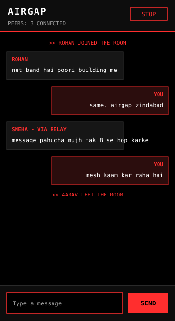

# AirGap

**Offline group messaging for Android. No internet, no server, no accounts.**

AirGap lets people standing near each other chat on their phones **without any network at all** — no mobile data, no Wi-Fi router, no SIM needed. Phones connect directly over Bluetooth and Wi-Fi Direct. The app does not request the `INTERNET` permission, so messages cannot leave the group of phones around you.

  

## What it does

- Open the app, enter any nickname, tap **START** — you are in one shared chat room with every AirGap phone nearby.
- Phones find each other automatically. There is nothing to set up and nobody hosts the room.
- If two phones are too far apart, a phone in the middle **relays** the message automatically, so it can travel up to 3 hops. The receiver sees a `VIA RELAY` label on relayed messages.
- Works with airplane mode on (turn Wi-Fi and Bluetooth back on after enabling it), during power cuts, in buildings with no signal, on trips — anywhere, as long as the phones are near each other.

## How it works

- Built on Google's **Nearby Connections** API with the `P2P_CLUSTER` strategy: every phone advertises and discovers at the same time and auto-connects to the others. Bluetooth is used for discovery, Wi-Fi Direct for sending the actual messages.
- Range is roughly **30–100 m per hop in open space, 10–30 m indoors** (walls reduce it, like any radio).
- Wire format: `MSG|<id>|<ttl>|<nickname>|<text>`. A new message starts with `ttl = 3`; each phone that relays it forwards it with `ttl − 1` and stops at 1. Every phone keeps a list of message ids it has already seen (max 500), so copies that arrive twice are dropped and messages cannot loop forever.
- A phone only relays while the app is open on it. Nothing is stored — if nobody is in range, a message has nowhere to go.

## Install

1. Go to the **Actions** tab of this repo, open the latest green **Build APK** run, and download the **`AirGap-debug-apk`** artifact. Inside it is `app-debug.apk`.
2. Open the `.apk` on your Android phone and allow **Install from this source** when Android asks (normal for apps installed outside the Play Store).
3. Open AirGap, allow the Bluetooth / nearby devices permissions, pick a nickname, tap **START**.

To test it: do the same on a second phone nearby and send a message. For the relay, put a third phone between two phones that are out of each other's range.

## Permissions

Bluetooth, Wi-Fi state, and location (Android asks for it for nearby-device discovery). **No `INTERNET` permission** — that is deliberate.

## Build from source

Open the project in Android Studio and let Gradle sync, or push to GitHub and let the Actions workflow build the APK. Requirements: JDK 17, Android SDK 34, Gradle 8.7, AGP 8.5.2, Kotlin 1.9.24, min SDK 26.

## Limitations

- Messages are **not encrypted yet**. Anyone in the room running AirGap can read them.
- Only phones with AirGap installed and open can take part — including as relays.
- Android only.

## Planned

- Longer relay range (raise ttl from 3 to 7)
- End-to-end encryption
- One-tap APK download through GitHub Releases

## Author

Parth Singh — B.Tech ECE, GLA University
https://parthsingh03.github.io · [@parthsingh03](https://github.com/parthsingh03)
